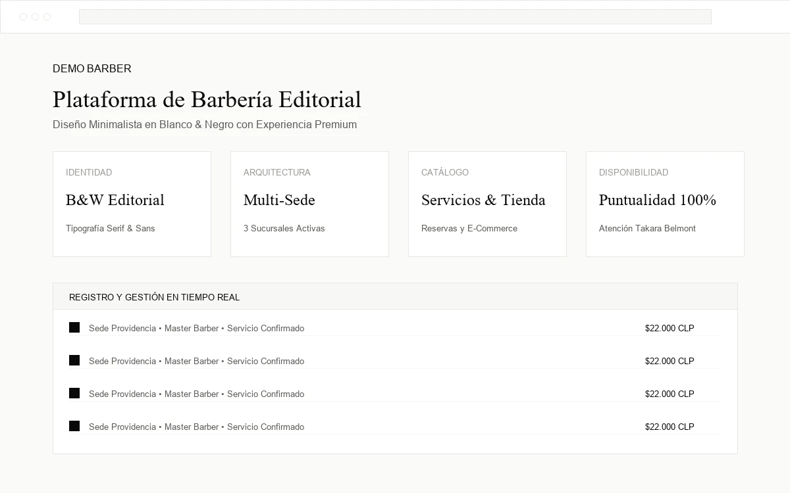
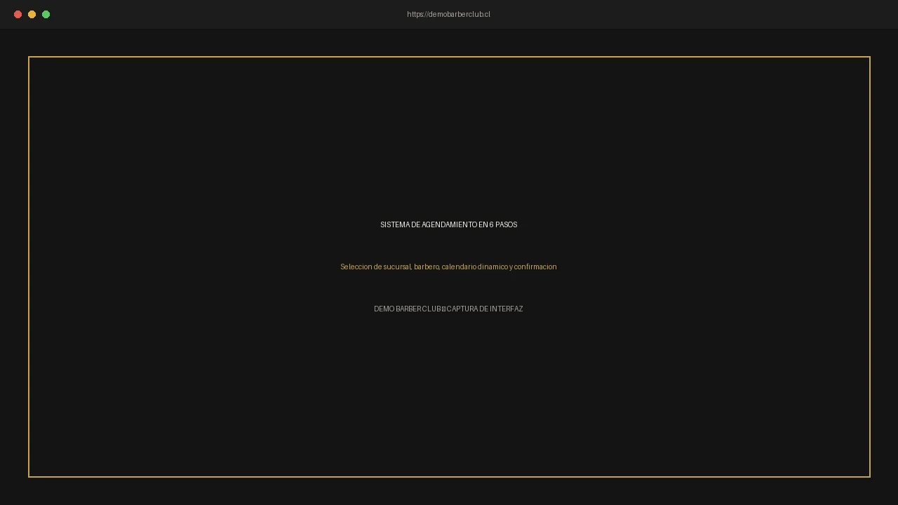
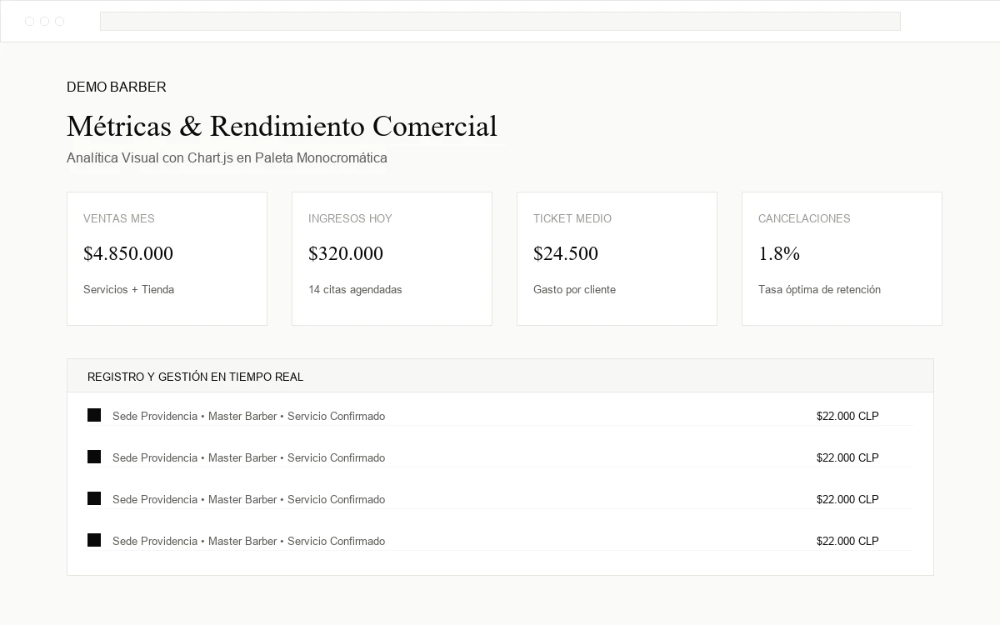
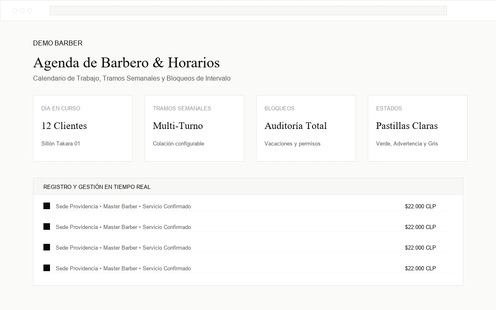

# Demo Barber Club — Plataforma Web Integral para Barberías de Lujo


Plataforma web comercial completa para barberías y salones masculinos de alta gama. Desarrollada para sorprender a dueños de negocios en presentaciones comerciales, con funcionamiento en tiempo real, arquitectura modular, diseño **Blanco y Negro (monocromático) minimalista y editorial** y facilidad de personalización para cada cliente.

---

## 🎨 Nueva Identidad Visual (Blanco & Negro Editorial)

La plataforma cuenta con un sistema de diseño minimalista, editorial y sobrio basado en la psicología del color:
- **Blanco (`#FFFFFF`)**: Limpieza, claridad, confianza y profesionalismo.
- **Negro (`#0A0A0A`)**: Elegancia, autoridad, precisión y alto nivel sin ruido visual.
- **Regla de Diseño**: *El color vive en la fotografía, no en la interfaz.* La UI es puramente monocromática, reservando únicamente colores funcionales desaturados para estados del sistema:
  * Éxito: `#2F7D4F`
  * Advertencia: `#B7791F`
  * Error: `#B3412F`

### Tokens Centralizados del Sistema

Todos los colores se configuran centralizadamente en `tailwind.config.js` y `static/css/input.css`:

```javascript
// tailwind.config.js
module.exports = {
  theme: {
    extend: {
      colors: {
        bg: {
          main: '#FFFFFF',        // Fondo principal
          alt: '#F7F7F5',         // Fondo alterno de secciones (blanco roto sutil)
          surface: '#FFFFFF',     // Superficie de tarjetas
          border: '#E7E7E4',      // Líneas y divisores finos (1px)
          dark: '#0A0A0A',        // Fondo invertido para Hero, CTA y Footer
        },
        brand: {
          black: '#0A0A0A',       // Negro de marca y botones primarios
          hover: '#262626',       // Hover de acción principal
        },
        text: {
          main: '#0A0A0A',        // Texto principal
          muted: '#5C5C58',       // Texto secundario
          dim: '#9A9A95',         // Texto terciario / deshabilitado
        },
        status: {
          success: '#2F7D4F',     // Éxito / Confirmada / En Stock
          warning: '#B7791F',     // Advertencia / Pendiente / Stock Bajo
          error: '#B3412F',       // Error / Cancelada / Agotado
        }
      }
    }
  }
}
```

---

## 🌟 Características Principales

### 1. Sitio Web Público de Lujo Editorial
- **Estética Editorial B&W**: Fondo principal blanco (`#FFFFFF`), alternancia sutil en blanco roto (`#F7F7F5`) y secciones invertidas puntuales en negro carbón (`#0A0A0A`) para el Hero, Banner CTA final y Footer.
- **Header Inteligente**: Transparente con logotipo blanco sobre el Hero a pantalla completa; al hacer scroll se convierte en blanco sólido con borde inferior sutil de 1px y logotipo en negro.
- **Tratamiento Fotográfico Editorial**: Tratamiento monocromático por defecto con transición suave a color al hacer hover (`img-editorial`).
- **Micro-interacciones y Animaciones**:
  * Preloader minimalista con animación de tijera en negro sobre fondo blanco.
  * Barra de progreso de lectura negra de 2px en el borde superior.
  * Cinta continua en movimiento (*marquee*) monocromática.
  * Contadores numéricos en tipografía serif de gran escala.
  * Acordeón FAQ y lightbox interactivo en blanco y negro.
- **Botones Flotantes de Contacto Directo**:
  * **WhatsApp** (`#25D366`) con sombra neutra y borde blanco de 2px.
  * **Instagram** con degradado oficial, sombra neutra y borde blanco de 2px.

### 2. Motor de Reservas Inteligente en Tiempo Real
- **Flujo en 6 Pasos con Barra de Progreso Monocromática**:
  1. Selección de Sucursal (Providencia, Las Condes, Vitacura).
  2. Selección de Servicio (duración, precio CLP, categoría).
  3. Selección de Master Barber o "Cualquier barbero disponible".
  4. Selector de Fecha y Horarios disponibles calculados dinámicamente:
     * Día seleccionado = relleno negro con texto blanco.
     * Día disponible = borde fino de 1px.
     * Día sin turno / domingo = gris claro tachado.
     * Hoy = día subrayado con etiqueta.
  5. Datos de contacto del cliente (con login automático o reserva express como invitado).
  6. Voucher de resumen y confirmación con checkmark dibujado en negro.
- **Algoritmo de Disponibilidad Multisede**:
  * Comprueba turnos y bloqueos en todas las sedes del barbero.
  * Asignación inteligente por menor carga de trabajo.
  * Prevención de colisiones atómicas con `transaction.atomic` y `select_for_update`.

### 3. Cuentas de Usuario y Jerarquía de Administración
- **Cuatro roles con alcance validado en el servidor**:
  * **ADMIN_MAESTRO**: Control total de la plataforma, selector global de sucursal, configuración general del sitio y catálogo base.
  * **ADMIN_SUCURSAL**: Administrador local con sedes asignadas (`AlcanceSucursalMixin` y protección HTTP 403 en backend).
  * **BARBERO**: Redirección directa a su agenda interactiva (`/panel/agenda/`).
  * **CLIENTE**: Historial de citas, vouchers y perfil personal en `/mi-cuenta/`.

### 4. Tienda Online e Inventario Multi-Sucursal
- Catálogo de productos con estética editorial y badges mínimos.
- Existencias independientes por sede física (`StockSucursal`).
- **Auditoría Inmutable (`MovimientoStock`)**: `ENTRADA`, `SALIDA`, `AJUSTE`, `VENTA`, `DEVOLUCION` y `TRASLADO` entre sedes.

### 5. Agenda de Barberos: Horarios Multi-Tramo y Bloqueos
- Configuración semanal por tramos horarios (ej. 10:00–14:00 y 15:00–20:00).
- Bloqueos administrativos, vacaciones, permisos y feriados con recurrencia opcional.
- Visualización de citas con pastillas funcionales claras y leyenda visible.

### 6. Dashboard de Administración (`/panel/`)
- Menú lateral blanco con borde derecho fino y enlace activo en negro `#0A0A0A` con texto blanco.
- Fondo de contenido `#FAFAF8`, tarjetas blancas y tablas limpias con hover sutil.
- **Chart.js Monocromático**: Gráficos con líneas finas negras, cuadrícula `#E7E7E4` y tooltips negros minimalistas.

---

## 📸 Capturas de Pantalla

| Portada Editorial | Flujo de Reserva en 6 Pasos |
| :---: | :---: |
|  |  |

| Dashboard Comercial (Chart.js) | Agenda Personal del Barbero |
| :---: | :---: |
|  |  |

---

## 🛠 Stack Tecnológico

- **Backend**: Django 5.x / 6.x (Python 3.12+)
- **Base de Datos**: SQLite (desarrollo local) / PostgreSQL (preparado para producción)
- **Estilos**: Tailwind CSS 3.4 (Tailwind CLI nativo con `tailwind.config.js`)
- **Interactividad**: JavaScript Vanilla (ES6+, modular, sin dependencias pesadas)
- **Visualización de Datos**: Chart.js 4.x (Paleta monocromática)
- **Gestión Multimedia**: Pillow (WebP, Favicons, Open Graph)

---

## 📦 Requisitos Previos

- Python 3.10 o superior.
- Node.js 18+ y npm (para compilación de estilos Tailwind).
- Git.

---

## 🚀 Instalación y Puesta en Marcha

### 1. Clonar el Repositorio
```bash
git clone https://github.com/tu-usuario/demo-barber.git
cd demo-barber
```

### 2. Activar Entorno Virtual de Python
En Windows:
```powershell
.\env\Scripts\activate
```
En Linux / macOS:
```bash
source env/bin/activate
```

### 3. Instalar Dependencias de Python
```bash
pip install -r requirements.txt
```

### 4. Instalar Dependencias de Node (Tailwind CLI)
```bash
npm install
```

### 5. Configurar Variables de Entorno
```bash
cp .env.example .env
```

### 6. Ejecutar Migraciones
```bash
python manage.py migrate
```

### 7. Cargar Datos de Demostración
```bash
python manage.py cargar_demo
```

### 8. Compilar Estilos CSS
Modo producción minificado:
```bash
npm run build
```
Modo desarrollo continuo (watch):
```bash
npm run dev
```

### 9. Iniciar el Servidor de Desarrollo
```bash
python manage.py runserver
```

Abre tu navegador en: **`http://127.0.0.1:8000/`**

---

## 👥 Cuentas de Acceso de Demostración

| Rol | Correo Electrónico | Contraseña | Alcance / Permisos | Destino Post Login |
| :--- | :--- | :--- | :--- | :--- |
| **ADMIN_MAESTRO** | `admin@demobarberclub.cl` | `admin123` | Control total, selector global, configuración y catálogo base | `/panel/` |
| **ADMIN_SUCURSAL** | `admin.providencia@demobarberclub.cl` | `admin123` | Exclusivo Sede Providencia (agenda, barberos, stock, pedidos) | `/panel/` |
| **ADMIN_SUCURSAL** | `admin.lascondes@demobarberclub.cl` | `admin123` | Exclusivo Sede Las Condes (agenda, barberos, stock, pedidos) | `/panel/` |
| **ADMIN_SUCURSAL** | `admin.vitacura@demobarberclub.cl` | `admin123` | Exclusivo Sede Vitacura (agenda, barberos, stock, pedidos) | `/panel/` |
| **BARBERO** | `barbero@demobarberclub.cl` | `barbero123` | Su propia agenda y registro de atenciones | `/panel/agenda/` |
| **CLIENTE** | `cliente@demobarberclub.cl` | `cliente123` | Historial de citas, pedidos y perfil personal | `/mi-cuenta/` |

---

## 🎨 Dónde Cambiar la Paleta de Colores

Toda la identidad visual está centralizada en dos únicos puntos:

1. **Tokens Tailwind (`tailwind.config.js`)**:
   - `colors.bg`: `main`, `alt`, `surface`, `border`, `dark`.
   - `colors.brand`: `black` (`#0A0A0A`), `hover` (`#262626`).
   - `colors.text`: `main` (`#0A0A0A`), `muted` (`#5C5C58`), `dim` (`#9A9A95`).
   - `colors.status`: `success` (`#2F7D4F`), `warning` (`#B7791F`), `error` (`#B3412F`).
2. **Variables y Utilidades CSS (`static/css/input.css`)**:
   - Variables `--color-bg-main`, `--color-brand-black`, `--color-text-main`, etc.
   - Utilidad `.img-editorial` para la transición de escala de grises a color al hover.
   - Estilo de las franjas diagonales del poste de barbero monocromático `.barber-pole-stripes`.

---

## 🧪 Pruebas Automáticas (Testing)

La suite incluye 14 pruebas automáticas que verifican alcance por sede, seguridad de roles, transacciones de stock, cálculo de turnos y bloqueos:

```bash
python manage.py test
```

---

## 📄 Licencia

Este proyecto está bajo la Licencia MIT. Consulta el archivo [LICENSE](LICENSE) para más detalles.
